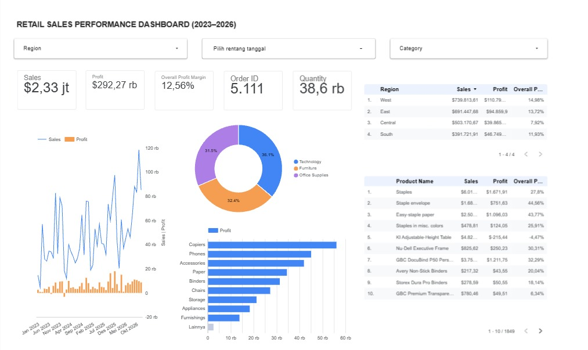

# retail-sales-performance-analysis

# Retail Sales Performance & Profitability Analysis (2023–2026)

🔗 **Interactive Dashboard:** [Buka Dashboard di Google Looker Studio]([Link_Dashboard_Looker_Studio_Kamu](https://datastudio.google.com/reporting/185e8aea-69d2-442f-a81f-552989b42328))

## 📌 Project Overview
Analisis komprehensif terhadap **10.192 transaksi retail** (Sample Superstore) untuk mengevaluasi kinerja pendapatan, pertumbuhan musiman, profitabilitas lini produk, performa regional, serta dampak strategi diskon terhadap margin keuntungan bersih.

## 🎯 Business Questions
1. Bagaimana kinerja penjualan, laba bersih, dan profit margin perusahaan secara keseluruhan?
2. Bagaimana tren pertumbuhan penjualan dari tahun ke tahun dan pola musiman (*seasonality*) bulanan?
3. Kategori dan sub-kategori produk mana yang menjadi penyumbang laba terbesar dan mana yang merugi?
4. Bagaimana perbandingan performa penjualan dan efisiensi margin antarwilayah (*Region*)?
5. Pada titik persentase berapa pemberian diskon mulai menggerus keuntungan perusahaan?

## 🛠️ Tools & Tech Stack
* **Python (Google Colab):** `Pandas`, `NumPy` (Data Cleaning, Deduplication, Feature Engineering)
* **Data Visualization:** `Matplotlib`, `Seaborn` (Exploratory Data Analysis)
* **Data Storage:** Google Sheets (Cloud Data Staging)
* **Business Intelligence:** Google Looker Studio (Interactive Executive Dashboard)

## 🧹 Data Preparation & Cleaning Highlights
* **Deduplication:** Menghapus 2 baris duplikat identik (`Exact Duplicates`) untuk mencegah *double counting* pada perhitungan omzet dan laba.
* **Data Type & Locale Standardization:** Memastikan integritas tipe data tanggal (`datetime`), kode pos alfanumerik (`string`), serta standardisasi format desimal untuk integrasi BI.
* **Feature Engineering:** Menambahkan metrik `Shipping Days`, ekstraksi periode waktu (`Order Year`, `Order Month-Year`), serta *Weighted Profit Margin* (`SUM(Profit) / SUM(Sales)`).

## 📊 Key Insights & Recommendations
* **Overall Performance:** Total Sales **$2.33M**, Total Profit **$292.27K**, dengan Overall Profit Margin **12.56%** dari **5.111 transaksi unik**.
* **Discount Threshold:** Diskon di atas **20%** menurunkan margin secara drastis, dan diskon **$\ge 30\%$** menyebabkan kerugian bersih per transaksi.
* **Product & Regional Action Plan:** Membatasi plafon diskon maksimal 20%, mengevaluasi strategi harga pada sub-kategori merugi (`Tables`, `Bookcases`, `Supplies`), serta mereplikasi kebijakan promosi wilayah **West** (margin 14.98%) ke wilayah **Central** (margin 7.92%).
